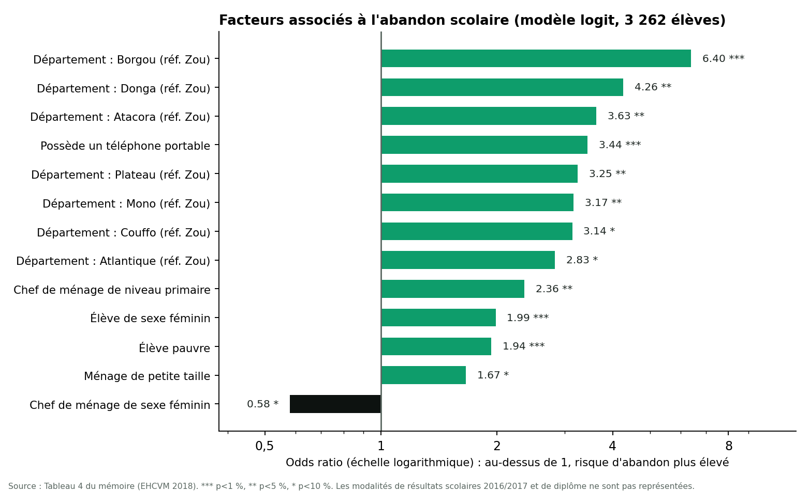
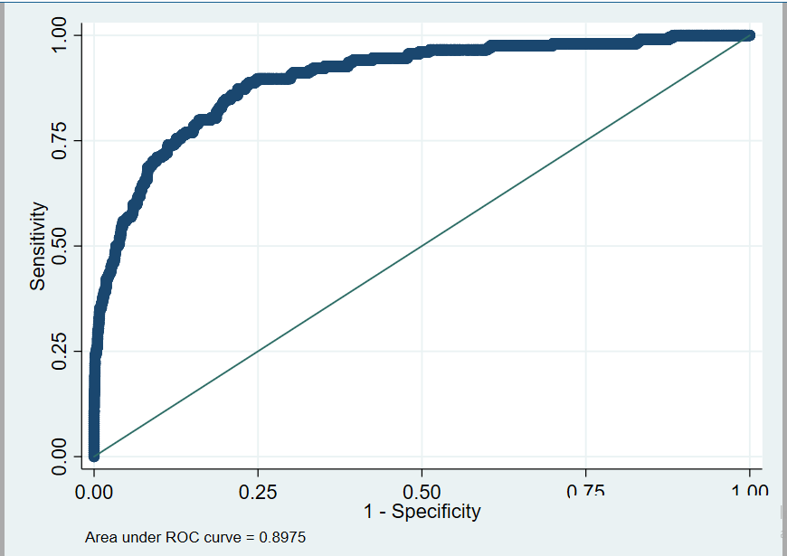
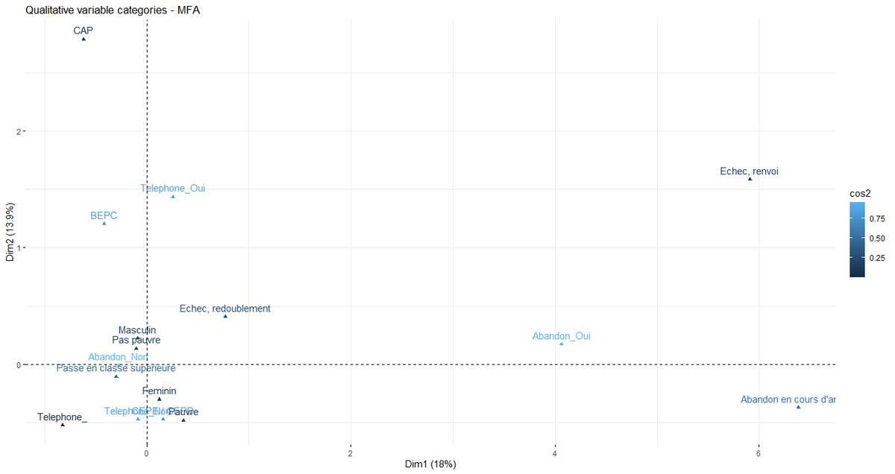

# Analyse des déterminants de l'abandon scolaire chez les adolescents du secondaire au Bénin

Mémoire de fin de formation, Licence en Planification (option Planification et gestion de projets), École Nationale d'Économie Appliquée et de Management (ENEAM), Université d'Abomey-Calavi, année 2022-2023.

Travail réalisé en binôme par Ariel Angelo K. HOUNKPATIN et Juste Joliange J. TOSSIN, sous la direction du Dr Roland MEDJIGBODO. Stage effectué au Ministère des Enseignements Secondaire, Technique et de la Formation Professionnelle (MESTFP), Direction de la Planification, de l'Administration et des Finances.

**Lire le mémoire complet : [Memoire-Licence-Abandon-scolaire-Benin-version-publique.pdf](Memoire-Licence-Abandon-scolaire-Benin-version-publique.pdf)** (84 pages). La page de dédicaces a été retirée de cette version publique.

## Question de recherche

Quels sont les facteurs déterminants de l'abandon scolaire chez les adolescents du secondaire au Bénin ? L'étude examine trois familles de facteurs : individuels, familiaux et liés au milieu de vie. Six hypothèses ont été testées : le sexe, les résultats scolaires (redoublement), la pauvreté, le niveau d'instruction du chef de ménage, la présence des parents dans le ménage et le milieu de résidence.

## Données

- **Source** : Enquête Harmonisée sur les Conditions de Vie des Ménages (EHCVM) 2018/19 du Bénin, programme PHMECV de la Banque mondiale et de la Commission de l'UEMOA. Questionnaires ménage et communautaire.
- **Champ** : élèves du secondaire âgés de 9 à 25 ans ayant fréquenté une école formelle en 2016/2017, hors diplômés de fin de cycle cette année-là.
- **Échantillon final** : 3 262 élèves, retenus parmi 38 100 individus enquêtés.
- **Variable expliquée** : abandon (1 si l'élève a abandonné, 0 sinon). Il concerne 6 % de l'échantillon pour l'année 2017/2018.

## Méthode

1. Apurement et jointure des bases, puis analyse univariée.
2. Analyse bivariée : tests du khi-deux et test exact de Fisher.
3. Analyse factorielle multiple (AFM) de variables qualitatives.
4. Régression logistique (logit), retenue face au probit sur les critères AIC et BIC, avec lecture des odds ratios.
5. Validation : proportion de prédictions correctes, test de spécification (linktest) et courbe ROC.

Outils : Excel, Stata 15 et RStudio.

## Résultats principaux

**Analyse bivariée.** Au seuil de 1 %, l'abandon est lié au département, au sexe, à la pauvreté, à la présence du père et de la mère dans le ménage, au niveau d'instruction du père, à la possession d'un téléphone, aux résultats de 2016/2017, aux causes scolaires et au diplôme le plus élevé. Le niveau d'éducation du chef de ménage est lié à 5 %. Le milieu urbain ou rural n'est pas significatif au test du khi-deux (p = 0,213) : l'effet du milieu de vie ressort surtout des écarts entre départements.

**Modèle logit.** Odds ratios significatifs (références : département du Zou, élèves non pauvres, sexe masculin) :

- Les odds d'abandon des filles sont environ 2 fois ceux des garçons (OR = 1,99).
- Par rapport au Zou, le risque est plus élevé dans plusieurs départements, avec un maximum dans le Borgou (OR = 6,40), puis la Donga (4,26) et l'Atacora (3,63).
- Posséder un téléphone portable est associé à des odds 3,4 fois plus élevés.
- Les élèves pauvres ont des odds 1,9 fois plus élevés.
- Un chef de ménage de niveau primaire est associé à des odds 2,4 fois plus élevés (référence : premier cycle du secondaire ou supérieur).
- Les élèves déjà en abandon ou renvoyés l'année précédente présentent un risque nettement plus élevé que ceux promus ou redoublants.

**Validation.** 95 % de prédictions correctes (à lire avec prudence : 94 % des élèves n'ont pas abandonné), spécification validée par le linktest (p = 0,886 pour le terme quadratique) et aire sous la courbe ROC de 0,8975.

L'AFM confirme visuellement les profils proches de l'abandon : élèves possédant un téléphone, redoublants, élèves renvoyés ou ayant interrompu l'année précédente.

## Recommandations

- Sensibiliser en continu les élèves et les parents, et renforcer la relation famille, élève et école.
- Mettre en place un dispositif de détection et de suivi des élèves à risque, et former les enseignants à ce repérage.
- Accompagner en priorité les filles et les élèves les plus âgés.
- Élargir les cantines scolaires au secondaire et développer des bourses pour les élèves en situation précaire.
- Améliorer l'offre scolaire en milieu rural.
- Instaurer un suivi-évaluation des mesures d'aide aux élèves et à leur famille.

## Limites

- Les facteurs liés au cadre scolaire, à la qualité de l'enseignement et au profil des encadreurs ne sont pas observés, et le nombre d'enfants du ménage n'a pas pu être cerné.
- Les données sont transversales : les résultats décrivent des associations, pas des relations de cause à effet.
- L'abandon étant rare (6 %), la courbe ROC est un meilleur indicateur de qualité que la proportion de prédictions correctes.

## Données et reproductibilité

Les microdonnées de l'EHCVM ne sont pas republiées dans ce dépôt. Elles relèvent des instances productrices de l'enquête (programme PHMECV de la Banque mondiale et de la Commission de l'UEMOA), dont il faut consulter les conditions d'accès.

## Contenu du dépôt

| Fichier | Rôle |
|---|---|
| `README.md` | Présentation du mémoire, de la méthode et des résultats |
| `Memoire-Licence-Abandon-scolaire-Benin-version-publique.pdf` | Mémoire complet, version publique |
| `figure-odds-ratios.png` | Odds ratios du modèle logit (Tableau 4 du mémoire) |
| `figure-courbe-roc.png` | Courbe ROC du modèle (aire = 0,8975) |
| `figure-afm-facteurs-individuels.png` | Plan factoriel des facteurs individuels (AFM) |

---
Ariel Angelo Kolawolé HOUNKPATIN, Ingénieur Statisticien Économiste, ENEAM, Université d'Abomey-Calavi
